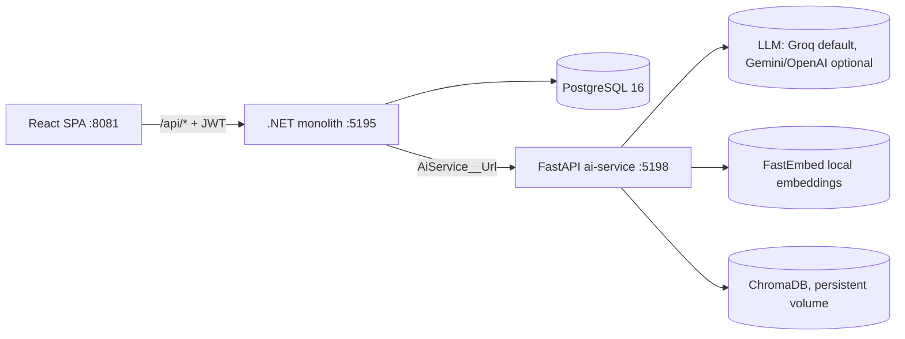

# MediConnect Health Hub

A telemedicine platform: patients book doctor appointments, exchange messages,
and use a RAG-based medical assistant that answers questions from their own
uploaded documents with source references.

## Features

**Patient**
- Register / login (JWT)
- Browse doctor profiles, book appointments
- Message doctors in conversations
- Upload PDF/TXT medical documents and ask the AI assistant questions
- See source references (document + page) for each answer

**Doctor**
- Login, view and confirm appointments
- Reply to patient messages

**Admin** (dev seed only)
- Login, dashboard stats, manage users, review/approve/reject doctor applications

## Architecture



Three deployables: `frontend/` (React), `monolith/` (ASP.NET Core),
`microservices/ai-service/` (Python/FastAPI).

## Stack

| Layer | Tech |
|---|---|
| Frontend | React 19, TanStack Router/Query, Vite 7, TypeScript 5.8, Tailwind 4 |
| Monolith | .NET 10, ASP.NET Core, EF Core 10, PostgreSQL 16 (SQLite fallback for dev) |
| AI service | Python 3.11, FastAPI 0.111, LangChain 0.3, ChromaDB 0.5, Groq `openai/gpt-oss-120b` (or Gemini/OpenAI), FastEmbed local embeddings |
| Auth | JWT Bearer (HS256), BCrypt password hashing |

## Run

```powershell
cd docker
copy .env.example .env   # then edit: set GROQ_API_KEY (free Groq key)
docker compose up -d --build
```

**Free tier setup (default):** the LLM uses Groq
(`LLM_PROVIDER=groq`, model `openai/gpt-oss-120b`, free API key from
https://console.groq.com/keys) and embeddings run locally with
FastEmbed — no paid API needed. Gemini and OpenAI remain available via
`LLM_PROVIDER=gemini` / `LLM_PROVIDER=openai` with the corresponding key.

> Free-tier note: use only public/test documents — never upload real
> patient data to external AI APIs.

- Frontend: http://localhost:8081
- Monolith API: http://localhost:5195
- AI service: http://localhost:5198

For local (non-Docker) development, each service has its own `.env.example`.

### Demo accounts (development only)

Seeded automatically on first run:

| Role | Email | Password |
|---|---|---|
| Admin | `admin@example.com` | `Admin12345!` (from `Seed__AdminPassword`) |
| Doctor | `sarah.mitchell@mediconnect.com` | `Password123!` |
| Patient | `john.doe@example.com` | `Password123!` |

Quick-login buttons on the login page appear only in dev mode (`npm run dev`).

## RAG walkthrough

1. Log in as a patient → **Assistant** page.
2. Upload a PDF or TXT medical document (sidebar). The ai-service extracts
   text (per-page for PDFs), splits it into overlapping chunks
   (`CHUNK_SIZE`/`CHUNK_OVERLAP`), embeds them locally with FastEmbed and
   stores them in a **per-user** ChromaDB collection.
3. Ask a question → relevant chunks are retrieved, passed to the LLM, and the
   answer is returned with `sources` (filename + page + snippet).
4. Questions unrelated to the uploaded documents get an explicit
   "not enough information" answer instead of invented content.

Re-uploading the same filename replaces its previous chunks (no duplicates).
Documents and conversations are isolated per user.

## End-to-end test

```powershell
# with the stack running and GROQ_API_KEY set
pwsh scripts/e2e.ps1
```

Covers: admin login, patient registration, appointment booking + confirmation,
messaging, PDF upload, two document-grounded questions, an off-topic question
(insufficient-context check), cross-user isolation (403/empty), and document
persistence across `docker compose restart`. Requires `test-data/sample.pdf`
(generate any small PDF there).

## Known limitations

- `EnsureCreated()` is used instead of EF migrations — schema changes require
  a database reset.
- JWT is stored in `localStorage` (XSS-exposed); there is no refresh-token flow.
- No automated unit tests; verification is via build + `scripts/e2e.ps1`.
- The assistant provides information only — it is not a diagnostic tool.

## Credits

Project initially developed as a team project with Hiba Ben Adou
(github.com/hiba400). This repository contains my version, focused on
backend security, the RAG document assistant, architecture simplification
and end-to-end validation.
